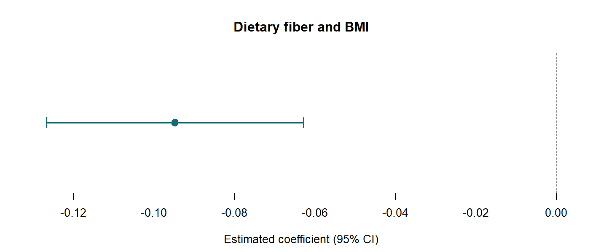

# NHANES Health Analytics

Reproduction workspace for the NHANES analysis from the University of Virginia Active Analytics team capstone. It explores associations of diet and physical activity with BMI, waist circumference, cholesterol, and fasting glucose. These are observational analyses.
## Selected result

In the survey-weighted BMI model, higher dietary fiber intake was
associated with lower BMI (β = −0.095, p < 0.001). This is an
observational association. The model in this repository uses a different
set of covariates from the original capstone report.



## Run the analysis

1. Download and unzip the repository.
2. Open `capstonefinalscript.Rmd` in RStudio. Keep `combined_data.csv`
   in the same folder as the R Markdown file.
3. If needed, install the R packages:

   ```r
   install.packages(c("rmarkdown", "knitr", "survey", "car"))
4. Click Knit to generate capstonefinalscript.html.
The analysis uses a processed NHANES dataset with 6,751 participant
records. The separate UVA campus survey is not included.
Reproduction status
The repository was downloaded and successfully knitted to HTML in
RStudio. The regenerated estimates have not yet been checked against
the original capstone report.
